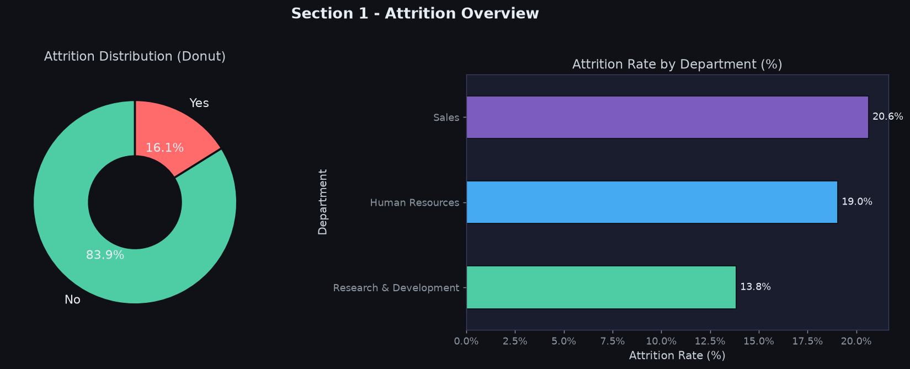
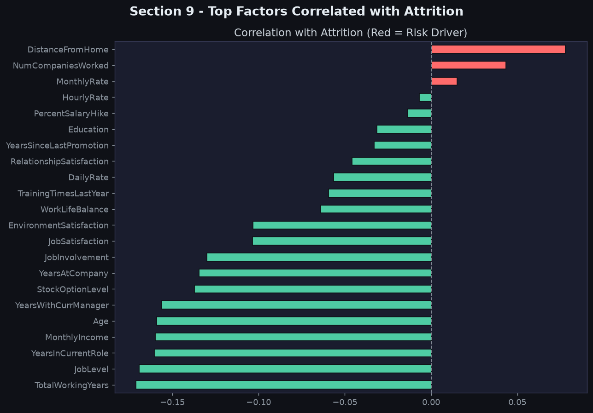
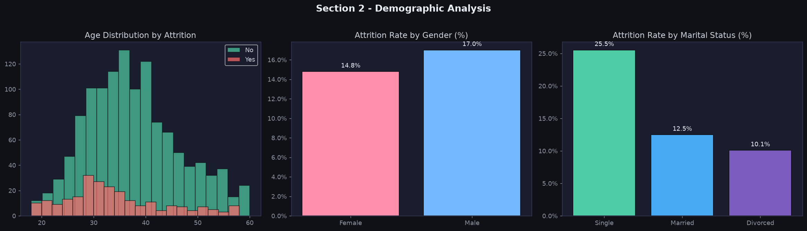

# 📊 HR Analytics — Employee Attrition Analysis

> **IBM HR Analytics Dataset** | EDA + Power BI Dashboard  
> Tools: Python · Pandas · Matplotlib · Seaborn · Power BI Desktop

---

## 🧠 Project Overview

This project analyses **why employees leave a company** using the IBM HR Analytics Employee Attrition dataset from Kaggle. It covers the full data analyst workflow:

- ✅ Data Cleaning
- ✅ Exploratory Data Analysis (EDA)
- ✅ 10 Dark-Themed Visualisations
- ✅ Business Insights & Recommendations
- ✅ Clean Dataset Export for Power BI

---

## 📁 Project Structure

```
hr-analytics-project/
│
├── data/
│   └── HR_Analytics_Clean.csv        # Cleaned dataset (ready for Power BI)
│
├── plots/                            # All EDA visualisations (10 charts)
│   ├── 01_attrition_overview.png
│   ├── 02_demographic_analysis.png
│   ├── 03_job_role_analysis.png
│   ├── 04_compensation_analysis.png
│   ├── 05_satisfaction_worklife.png
│   ├── 06_overtime_travel.png
│   ├── 07_tenure_experience.png
│   ├── 08_correlation_heatmap.png
│   ├── 09_attrition_risk_factors.png
│   └── 10_age_income_heatmap.png
│
├── hr_analytics_eda.py               # Main EDA script
├── requirements.txt                  # Python dependencies
├── .gitignore
└── README.md
```

---

## 📦 Dataset

| Property | Value |
|----------|-------|
| Source | [Kaggle — IBM HR Analytics](https://www.kaggle.com/datasets/pavansubhasht/ibm-hr-analytics-attrition-dataset) |
| Rows | 1,470 employees |
| Columns | 35 (raw) → 39 (after feature engineering) |
| Target | `Attrition` (Yes / No) |

### Raw Columns (selected)

| Column | Type | Description |
|--------|------|-------------|
| `Age` | int | Employee age |
| `Attrition` | str | Target: Yes = Left, No = Stayed |
| `Department` | str | HR / Research & Development / Sales |
| `MonthlyIncome` | int | Monthly salary ($) |
| `JobRole` | str | 9 unique roles |
| `JobSatisfaction` | int | 1 (Low) → 4 (Very High) |
| `OverTime` | str | Yes / No |
| `YearsAtCompany` | int | Tenure in years |
| `WorkLifeBalance` | int | 1 (Bad) → 4 (Best) |
| `BusinessTravel` | str | Non-Travel / Travel_Rarely / Travel_Frequently |

---

## 🧹 Data Cleaning Steps

| Step | Action |
|------|--------|
| 1 | Dropped 3 **constant columns**: `EmployeeCount`, `Over18`, `StandardHours` |
| 2 | Created **binary target**: `Attrition_Flag` (1 = Yes, 0 = No) |
| 3 | Mapped **Education** to readable labels (Below College → Doctor) |
| 4 | Mapped **Satisfaction scores** to Low / Medium / High / Very High |
| 5 | Mapped **WorkLifeBalance** to Bad / Good / Better / Best |
| 6 | Binned **Age** into 5 bands: 18-25, 26-35, 36-45, 46-55, 56-65 |
| 7 | Binned **MonthlyIncome** into 4 bands: Low / Mid / High / Very High |

No missing values were found in this dataset.

---

## 📊 EDA Visualisations

| # | Chart | Insight |
|---|-------|---------|
| 1 | **Attrition Overview** | 16.1% overall; Sales dept has highest rate (20.6%) |
| 2 | **Demographics** | Age 18-25 leaves most; Singles at 25.5% |
| 3 | **Job Roles** | Lab Technicians & Sales Reps are highest-risk roles |
| 4 | **Compensation** | Attrition drops sharply above $6,000/month |
| 5 | **Satisfaction × OT** | Low satisfaction + OverTime = 50%+ attrition |
| 6 | **OverTime & Travel** | OverTime: 30.5% vs 10.4% — biggest single driver |
| 7 | **Tenure** | Two crisis points: Year 0–1 and Year 5 |
| 8 | **Correlation Matrix** | TotalWorkingYears and MonthlyIncome strongly correlated |
| 9 | **Risk Factors** | OverTime & DistanceFromHome = top positive predictors |
| 10 | **Age × Income Heatmap** | Young + Low Income = extreme attrition risk zone |

---

## 🔍 Key Business Insights

| Insight | Value | Action |
|---------|-------|--------|
| **Overall Attrition Rate** | 16.1% | Above 15% industry avg — action needed |
| **Overtime Attrition** | 30.5% | 3× non-OT rate → cap mandatory overtime |
| **New Hire Attrition (≤ 1 yr)** | 34.9% 🔴 | Strengthen onboarding & mentorship |
| **Low Income (<Q1) Attrition** | 29.3% | Review entry-level compensation |
| **Single Employees** | 25.5% | Offer flexible hours & engagement programs |
| **Sales Executives** | 17.5% | Commission structure & career path review |
| **Frequent Travellers** | 24.9% | Travel policy reform needed |

---

## ⚡ HR Recommendations

1. **Cap OverTime** — Biggest lever; reduce mandatory OT immediately
2. **Compensation Review** — Employees below $2,911/mo have 29% attrition
3. **Onboarding Program** — 35% of new hires leave in Year 1 — add buddy system & 90-day check-ins
4. **Sales Retention** — Restructure commissions + defined career ladder
5. **Travel Policy** — Introduce hybrid travel limits & increased allowances
6. **Early Warning Dashboard** — Flag employees with: OverTime=Yes + JobSat≤2 + Tenure≤3 yrs

---

## 🚀 How to Run

### 1. Install dependencies
```bash
pip install -r requirements.txt
```

### 2. Run the EDA script
```bash
python hr_analytics_eda.py
```

This will:
- Load `data/HR_Analytics_Clean.csv`
- Print descriptive stats & insights to console
- Generate 10 plots in the `/plots` folder

### 3. Open in Power BI
Load `data/HR_Analytics_Clean.csv` into Power BI Desktop and build:
- **Page 1**: Executive Summary (KPI cards, attrition donut, dept bar)
- **Page 2**: Demographics (age bands, gender, marital status)
- **Page 3**: Job & Role Analysis (role bar, job level, treemap)
- **Page 4**: Compensation (income histogram, income band bar, scatter)
- **Page 5**: Satisfaction & WLB (heatmap, WLB bar, env satisfaction)
- **Page 6**: Risk Profile (OT rate, new hire rate, age×income matrix)

#### Key DAX Measures for Power BI
```dax
Attrition Rate =
DIVIDE(
    CALCULATE(COUNT(HR_Analytics_Clean[EmployeeNumber]),
              HR_Analytics_Clean[Attrition] = "Yes"),
    COUNT(HR_Analytics_Clean[EmployeeNumber]), 0
)

Employees Left =
CALCULATE(COUNT(HR_Analytics_Clean[EmployeeNumber]),
          HR_Analytics_Clean[Attrition] = "Yes")

Avg Monthly Income = AVERAGE(HR_Analytics_Clean[MonthlyIncome])

Overtime Attrition Rate =
CALCULATE([Attrition Rate], HR_Analytics_Clean[OverTime] = "Yes")

New Hire Attrition =
CALCULATE([Attrition Rate], HR_Analytics_Clean[YearsAtCompany] <= 1)
```

---

## 🛠 Tech Stack

| Tool | Purpose |
|------|---------|
| Python 3.x | Core analysis |
| Pandas | Data manipulation |
| NumPy | Numerical operations |
| Matplotlib | Visualisations |
| Seaborn | Statistical plots & heatmaps |
| Power BI Desktop | Interactive dashboard |

---

## 📈 Sample Visualisations

### Attrition Overview


### Attrition Risk Factors


### Demographic Analysis


---

## 👤 Author

**Sidhanth Tyagi**  
Data Analyst | Python · SQL · Power BI · Machine Learning

---

## 📄 License

This project is open source under the [MIT License](LICENSE).  
Dataset credit: [IBM HR Analytics — Kaggle](https://www.kaggle.com/datasets/pavansubhasht/ibm-hr-analytics-attrition-dataset)
